```{=html}
<!-- 
below modfies the quarto to create print to pdf button and change HTML document to print friendly by changing the format.
-->
```

::: print-button-container
<button id="printButton" class="print-button">

Print to PDF

</button>
:::

```{=html}
<style>
/* General styles for the browser view (from Quarto theme) are untouched */

.print-button-container {
  margin-top: 20px;
  text-align: right;
}

.print-button {
  background-color: #007bff;
  color: white;
  border: none;
  padding: 10px 15px;
  font-size: 14px;
  border-radius: 5px;
  cursor: pointer;
}

.print-button:hover {
  background-color: #0056b3;
}

/* Print-specific styles (only active when .print-mode is applied) */
.print-mode body {
  background-color: white;
  color: black;
  font-size: 12pt;
}

.print-mode .print-button-container {
  display: none; /* Hide the print button during printing */
}

.print-mode h1, .print-mode h2, .print-mode h3 {
  page-break-after: avoid;
}

.print-mode p {
  margin: 1em 0;
}

.print-mode table {
  width: 100%;
  border-collapse: collapse;
}

.print-mode th, .print-mode td {
  border: 1px solid #000;
  padding: 5px;
}

@page {
  size: auto;
  margin: 1in;
  @bottom-center {
    content: "Page " counter(page) " of " counter(pages);
    font-size: 10pt;
    color: #666;
  }
}

@media print {
  body {
    counter-reset: page;
  }

  .print-button-container {
    display: none !important;
  }

  /* Optional: Add page number footer manually for compatibility */
  footer::after {
    content: "Page " counter(page);
    display: block;
    text-align: center;
    font-size: 10pt;
    color: #555;
    margin-top: 2em;
  }
}
</style>
```

```{=html}
<script>
document.getElementById("printButton").addEventListener("click", function () {
  // Add the print-specific class to the <html> element
  document.documentElement.classList.add("print-mode");

  // Trigger the print dialog
  window.print();

  // Remove the print-specific class after a brief delay
  setTimeout(function () {
    document.documentElement.classList.remove("print-mode");
  }, 1000);
});
</script>
```

```{r}
#| label: setup
#| include: false
knitr::opts_chunk$set(echo = FALSE, dpi = 400)
```

# Background

Sound climate data and climate extremes information at local to regional scale are essential for climate policy, impact assessment, and adaptation planning, as changes in extreme climate are more impactful than average shifts [@Seneviratne2012]. To provide reliable and consistent information on climate extreme in British Columbia (BC), we developed the <a href="https://bcgov-env.shinyapps.io/bc_climate_extremes_app/" target="_blank"> `bc_climate_extremes_app` </a> (**CEIapp**), an interactive R Shiny application. The CEIapp makes available more than 70 climate extreme indices (CEIs) calculated for BC and BC’s Eco-provinces/regions/sections, major watersheds, <a href=" https://www2.gov.bc.ca/gov/content/data/geographic-data-services/topographic-data/freshwater" target="_blank"> Fresh Water Atlas (FWA) watersheds </a>, <a href="https://www2.gov.bc.ca/gov/content/industry/forestry/managing-our-forest-resources/forest-landscape-plans "target="_blank"> forest landscape plans (FLP) </a> boundaries, and municipalities. These indices are derived from the Multi-Source Weather <a href="https://www.gloh2o.org/mswx/" target="_blank"> (MSWX) </a> gridded dataset [@Beck2022] of daily resolution minimum and maximum temperature and precipitation for 1979 - 2024, with plans for periodic updates to include the most recent years. Several CEIs also incorporate latitude, longitude, and month of the year to account for spatial and seasonal variability. The app provides data and visualizations of annual, seasonal and monthly climatology (average of 1981-2010), anomalies, and linear and spatial trends of the CEI for the selected region of interest. While in-situ observations are the primary source of changing climate extremes information, they are often spatially sparse, temporally incomplete, and unevenly distributed, particularly in remote or data-scarce regions. Therefore, we use MSWX gridded datasets that address these gaps by providing spatially continuous and temporally consistent coverage, enabling analyses in poorly monitored areas and supporting applications such as climate attribution, model evaluation, and adaptation planning. However, the gridded data and CEIs calculated using them may come with uncertainties likely from quality and quantity of underlying observed data as well as interpolation and assimilation method implemented in the gridded dataset [@Smith2025]. Therefore, evaluating the agreement between gridded- and observation-based CEIs is important for assessing the reliability, limitations and caveats of the CEIs derived from gridded data. In this context, this document presents an evaluation of MSWX gridded climate data used to calculate CEIs and selected CEIs generated and visualized in the CEIapp. The primary objectives are: (1) to evaluate the consistency and performance of the MSWX gridded dataset based CEIs presented in the app by comparing them with equivalent indices derived from observations or established reference datasets across BC; (2) to examine how well heat, cold, and precipitation extremes are represented across BC and (3) to clarify the calculation methods for specific CEIs whose definitions or computational procedures are insufficiently documented in the app [Appendix 1](#appendix1). Although the app includes over 70 CEIs [Appendix 1](#appendix1), this evaluation is limited to daily data that are used to calculate CEIs across BC and on a subset of indices that adequately represent the extremes calculated in the app namely, extreme heat and cold days, extreme precipitation indices, sector specific the drought index Standardized Precipitation Evapotranspiration Index (SPEI) and Heatwave indices.

# Data and Methods

## Data

### Observation data

We used the observed daily climate data from 148 temperature stations and 182 precipitation stations across BC (@fig-stnloc) to evaluate the CEIs, following the rigorous quality control of the observations. The data were compiled from different sources including Environment and Climate Change Canada (ECCC) stations, BC Hydro and BC Ministries’ stations.

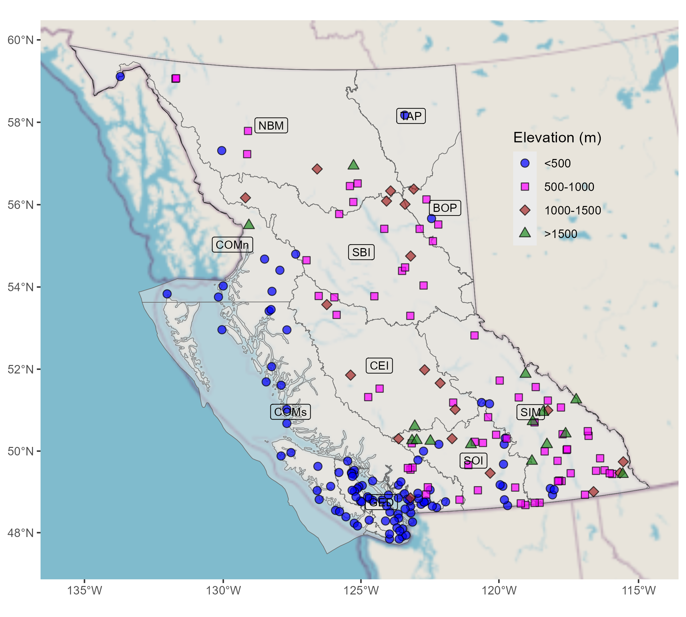{#fig-stnloc width="100%"}

First, we applied quality control criteria, retaining only stations that met all of the following conditions: (i) less than 5 % missing data over the period of record, (ii) more than 30 years of data, and (iii) must have data for 2021 or after that year. We also removed physically implausible values. For stations with small remaining gaps, we applied gap-filling procedures: if missing periods were shorter than three consecutive days for precipitation or five days for temperature, we interpolated between the nearest available values. For longer gaps, we replaced the missing values with the means of all observations for the same calendar day across the record. The resulting quality-controlled dataset was then used to calculate CEIs for each station and evaluation analysis.

### Gridded data

MSWX [@Beck2022] daily precipitation and minimum and maximum temperature data are used to calculate CEIs and implemented in the CEIapp. The MSWX is a 9 km × 9 km spatial resolution daily data since 1979. The historical data used here (up to 2024) are based on the ERA5 with bias-corrected and downscaled using high-resolution reference monthly and annual climatology. This dataset has significant advantages over other gridded data like ERA5 but may come with caveats and limitations discussed later. For the current analysis, we limit the temporal extent to 2024, the most recent year for which complete data were available. The app will be updated periodically to incorporate CEIs for subsequent years.

## Methods

We evaluated the MSWX daily data to explore how well the data are represented followed by evaluation of how well CEI from MSWX capture extreme heat, extreme cold and heavy precipitation events as well as compare the time series of hottest day, warmest night and maximum 5-day precipitation amount and number of heavy precipitation days. In addition, we evaluate how well the SPEI and heatwave data are represented in the CEIapp. While the app includes over 70 CEIs [Appendix 1](#appendix1), we focus here on a subset of core indices; extreme heat days(EHDs) define as daily maximum temperature at or above summer (June - August) 95th percentile, extreme cold days (ECDs) defined as daily minimum temperature at or below winter ( December – February) 5th percentile and Heavy precipitation days ( HPDs) defined as days when daily precipitation exceed 99th percentile [@Smith2025; @Alexander2016]. These fundamental percentiles based extreme indices not only provide direct insight into extreme climate events but also serve as indicators of how well other CEIs are likely to perform. We categorized all stations into four elevation ranges: \<500 m, 500–1000 m, 1000–1500 m, and \>1500 m, and performed a comparative analysis across these elevation bands. This approach helps to better assess the topographical variation in the representation of CEIs by the MSWX data. The number of stations varies among elevation bands, with the highest concentration located at elevations \<500 m (@fig-stnloc).

We apply statistical metrics including bias, root mean square error (RMSE), and the ratio of standard deviations (rSD) to assess how well the daily gridded data matches the observations. Bias measures the average magnitude and direction of differences, indicating whether the gridded data are systematically higher or lower than the observations. RMSE represents the square root of the mean of squared differences. The rSD measures relative variability, with 1 indicating identical variability, values \<1 indicating MSWX is less variable, and values \>1 indicating it is more variable than observations. We conduct visual comparisons using Taylor diagrams, one-on-one scatter plots, box-and-whisker plots, and time series plots to examine the agreement and distribution patterns between datasets. Taylor diagrams [@Taylor2001] provide a compact visual summary of how well the gridded datasets match the observations. In Taylor diagrams, the points closer to the observation curve often indicated by a line passing through normalized standard deviation of 1 indicate better agreement with observation.

We use the mean absolute error (MAE, mean absolute percentage error (MAPE) for precipitation) as the primary metric to quantify the ability of the gridded CEIs (EHDs, ECDs, and HPDs) to represent the observed station CEIs. The MAE measures average magnitude of the error in EHDs and ECDs while MAPE measures the average error magnitude as percentage for HPDs. Further, we calculated the percentage match for EHDs, ECDs and HPDs. The percentage match is defined as the ratio of days where MSWX data values exceeded the extreme event threshold (EHD, ECD, or HPD) to the total number of days where the station observations met or exceeded that same threshold. This assesses how often MSWX data correctly identifies an extreme event on the same day it occurred as in the station observations.

# Results

## Daily data comparison

### Daily maximum and minimum temperature

On average, the daily MSWX Tmax exhibits a consistent negative bias compared to observations across all elevation bands, except at \>1500 m, indicating that MSWX slightly underestimates daily maximum temperature for most of BC (@tbl-dly_tmin_tmx_comp and @fig-tmp_bias). The mean RMSE exceeds 3 °C. The rSD increases from 0.93 at lower elevations to 1.04 at \>1500 m, indicating that the variability in representing Tmax improves from being 7% lower than observations at low elevations to nearly identical at high elevations (@tbl-dly_tmin_tmx_comp). For Tmin, the average bias is consistently positive across BC, with only a few stations showing negative bias (@tbl-dly_tmin_tmx_comp and @fig-tmp_bias). RMSE is below 3 °C for most low-elevation stations but rises to over 4 °C for high-elevation stations. Variability in MSWX Tmin closely matches that of the observations, with rSD values near 1 for most stations (@fig-tmp_bias). Furthermore, the Taylor diagram for Tmax (BC average and elevation bands) shows high correlations (0.95–0.98) between MSWX and observed data, with MSWX having slightly lower variability than observations. Stations in the 1000–1500 m elevation range show the best agreement, compared to both lower and higher elevation groups (@fig-tmp_dly_ty). For Tmin, the agreement is even stronger, with the BC average and all elevation bands clustering closer to the reference line than for Tmax (@fig-tmp_dly_ty).

| Elevation band | Variable | Bias  | RMSE | rSD (% of variability) |
|----------------|----------|-------|------|------------------------|
| \<500          | Tmax     | -1.86 | 3.15 | 0.93 (7% less)         |
|                | Tmin     | 0.55  | 2.44 | 1.01 (1% more)         |
| 500–1000       | Tmax     | -2.21 | 3.92 | 0.95 (5% less)         |
|                | Tmin     | 0.35  | 3.51 | 1.02 (1% more)         |
| 1000–1500      | Tmax     | -0.87 | 4.01 | 0.98 (2% less)         |
|                | Tmin     | 1.39  | 4.00 | 0.96 (4% less)         |
| \>1500         | Tmax     | 0.46  | 3.96 | 1.04 (1% more)         |
|                | Tmin     | 1.19  | 3.91 | 1.00 (1% more)         |
| BC average     | Tmax     | -1.68 | 3.56 | 0.95 (5% less)         |
|                | Tmin     | 0.62  | 3.08 | 1.01 (1% more)         |

: Average comparison coefficients by elevation bands for daily minimum and maximum temperatures. {#tbl-dly_tmin_tmx_comp}

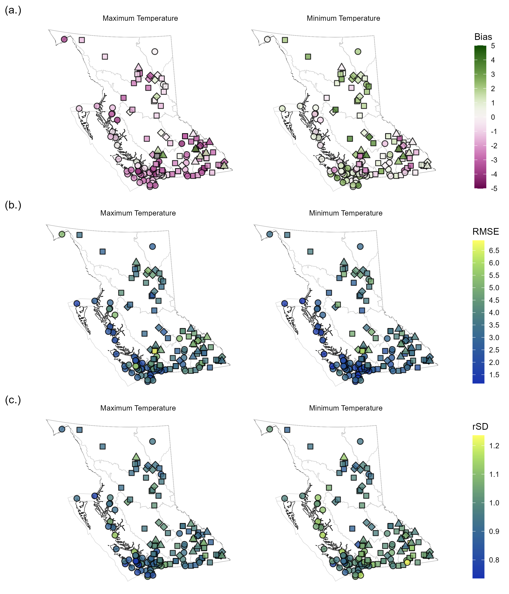{#fig-tmp_bias width="100%"}

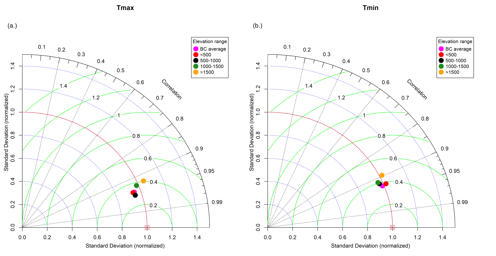{#fig-tmp_dly_ty width="100%"}

### Daily precipitation

The representation of daily precipitation in MSWX is notably weaker than that of temperature, exhibiting a mean positive bias that increases with elevation. This bias ranges from 0.84% at mid-elevations (1000–1500 m) to nearly 33% at higher elevations (\>1500 m) (@tbl-dly_prcp_comp). At a station level, the biases are highly variable; three stations across different elevation bands report a positive bias exceeding 100%, while the lowest negative bias for a station is 82% (@fig-prcp_bias a). RMSE values are particularly high at low-elevation coastal stations. The rSD further highlights this discrepancy, indicating that the MSWX dataset underestimates the variability in daily precipitation compared to observations by approximately 4% at lower elevations and 22% at higher elevations. The combination of large and variable biases (both positive and negative), elevated RMSE, and higher rSD values (fig-prcp_bias) reflect the limitation of MSWX dataset in accurately representing orographic processes and localized convective precipitation, particularly in the complex terrain of the coastal regions of BC compared to other regions.

| Elevation band | Bias  | RMSE | rSD (% of variability) |
|----------------|-------|------|------------------------|
| \<500          | 16.07 | 8.11 | 0.96 (4% less)         |
| 500–1000       | 31.45 | 3.87 | 0.92 (8% less)         |
| 1000–1500      | 0.84  | 6.02 | 0.78 (22% less)        |
| \>1500         | 32.98 | 5.27 | 0.78 (22% less)        |
| BC average     | 20.90 | 6.24 | 0.92 (8% less)         |

: Average comparison coefficients by elevation bands for daily precipitation . {#tbl-dly_prcp_comp}

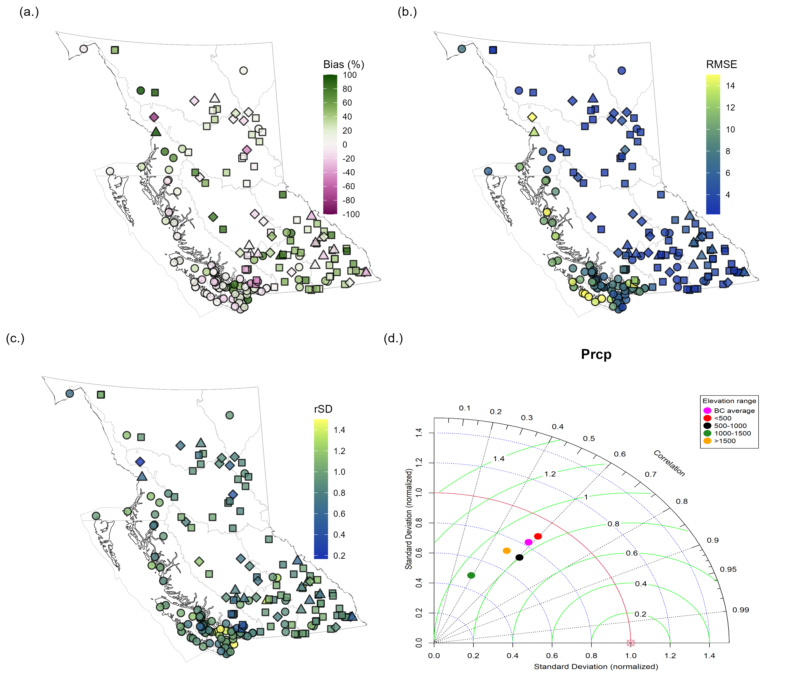{#fig-prcp_bias width="100%"}

## Extremes comparison

### Extreme heat days (EHDs) and extreme cold days (ECDs)

@fig-ehd_ecd_comp a shows the number of extreme heat days (EHDs), defined as summer days exceeding the 95th percentile of maximum temperature, while @fig-ehd_ecd_comp b presents the corresponding MAE values. The MAE for EHD is generally lowest at low- to mid-elevation stations, increasing with elevation, though with a few station-specific exceptions. Some coastal stations report relatively high MAE values (\>5 °C).\@fig-ehd_ecd_comp c and 5d depict the extreme cold days (ECDs), defined as the winter 5th percentile threshold, and their associated MAE values. For ECDs, the MAE is typically lower (\<5 °C) than for EHD. Coastal and lower-elevation stations consistently exhibit lower MAE compared to higher-elevation and interior stations (@fig-ehd_ecd_comp d). Despite some topographic influences, MSWX captures the spatial variability in EHDs and ECDs reasonably well: over 60% of stations report MAE \<5 °C for EHDs, while 99% of stations report MAE \<5 °C for ECDs.

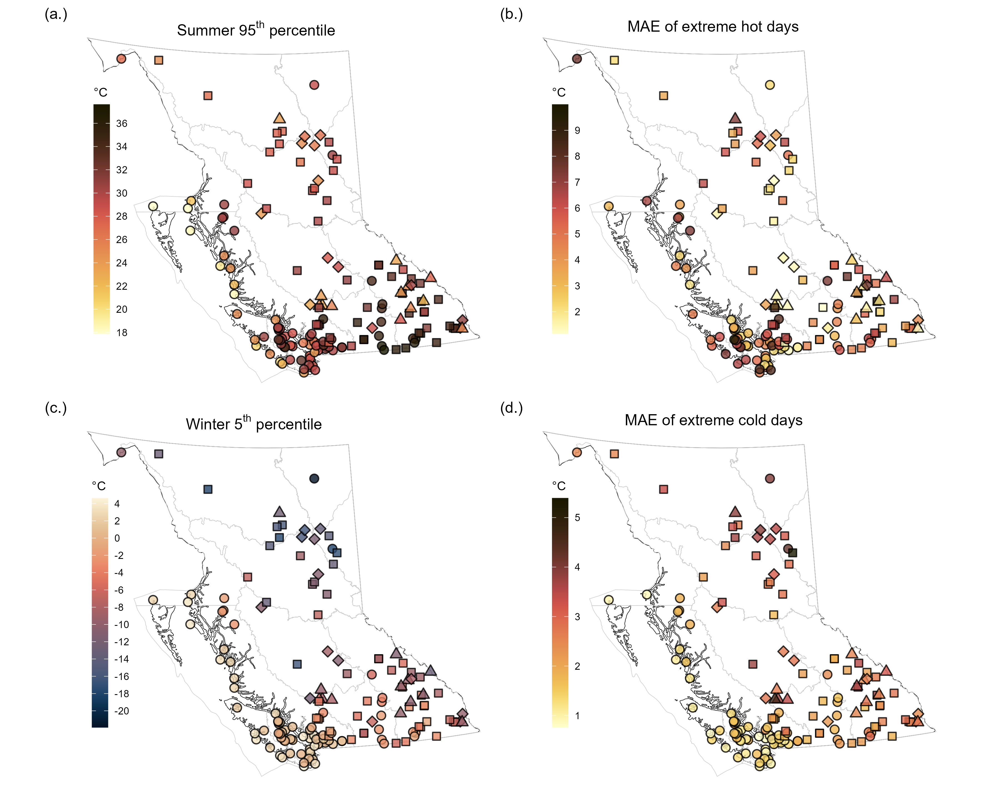{#fig-ehd_ecd_comp width="100%"}

### Heavy precipitation days (HPDs)

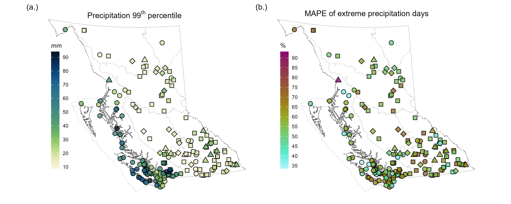{#fig-hpd_comp width="100%"}

The heavy precipitation days (HPDs) threshold, defined as the 99th percentile of daily precipitation, is shown in Figure 6a, with the corresponding MAPE values in Figure 6b. As expected, the coastal and mountainous regions of BC exhibit higher HPD thresholds compared to the interior and lower-elevation regions (@fig-hpd_comp a). The lowest MAPE values are generally observed at low- to mid-elevation stations, though with some exceptions, while higher MAPE values are scattered across northern, mountainous, and few coastal stations. This indicates that MSWX precipitation is limited in its ability to capture localized and convective extreme precipitation events. Because daily precipitation biases are mixed (both positive and negative) and MAPE values vary spatially, MSWX tends to either under- or overestimate extremes depending on the region. Overall, MSWX reproduces daily and extreme precipitation reasonably well in lower-elevation and less topographically complex areas of BC but performs less reliably in mountainous and northern regions. This highlights one of the limitations and challenges of gridded datasets in capturing often highly localized nature of HPDs.

Overall, the distribution plots of MAE (MAPE for precipitation) indicate that the MSWX is more accurate at representing the ECDs than EHDs as indicated by the lower and less variable MAE for ECDs. The HPDs median MAPE of 55% suggest that the extreme precipitation are generally less accurate than the temperature extremes (@fig-bxw_comp).

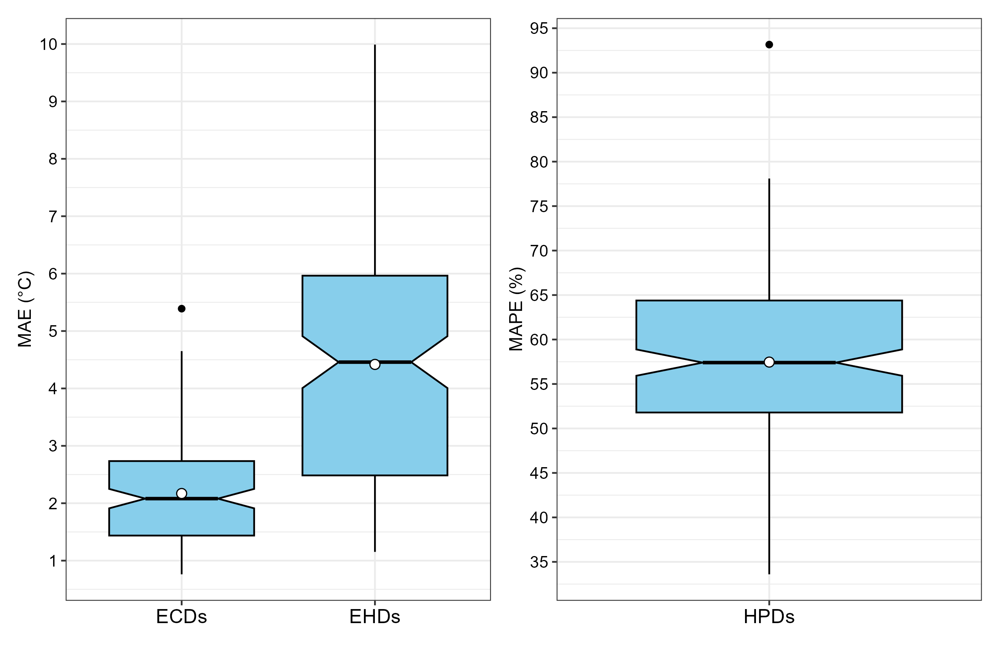{#fig-bxw_comp width="100%"}

### Percentage match in extreme values

In addition to the above analysis, we evaluated the percentage match of EHDs, ECDs, and HPDs to assess how well MSWX captures the timing of extreme events. The results (@fig-per_match) show that ECDs are better represented in MSWX than EHDs. The higher match for ECDs is likely due to the more uniform distribution of dense cold air compared to relatively localized nature of extreme heat events. HPDs show lower matches, particularly along coastal regions where thresholds are higher, while drier inland areas with lower thresholds exhibit somewhat better agreement.

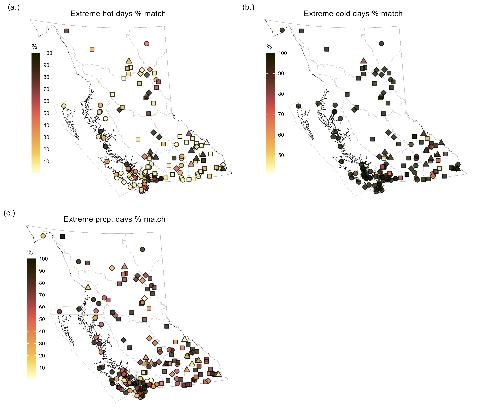{#fig-per_match width="100%"}

### Time series analysis of selected CEIs

We evaluated temporal evolution of four fundamental CEIs related to extreme heat, cold and precipitation namely TXn ( coldest day; annual lowest value of daily maximum temperature), TNx (warmest night; annual highest value of daily minimum temperature ), RX1day (annual maximum 1 day precipitation) and R10mm (annual count of days when precipitation amount is ≥10 mm) stations averaged across different elevation bands of BC.

#### TXn (coldest day) and TNx (warmest night)

@fig-tnx_txn_ts shows the comparison of the temporal evolution of TXn and TNx from observed station data and MSWX across different elevation bands in BC. MSWX generally agrees with observations and captures annual variability of these indices fairly well across all elevation bands. At lower elevations (\<500 m), TXn is slightly underestimated and TNx overestimated, reflecting MSWX imitations in representing localized extremes in coastal and valley regions.

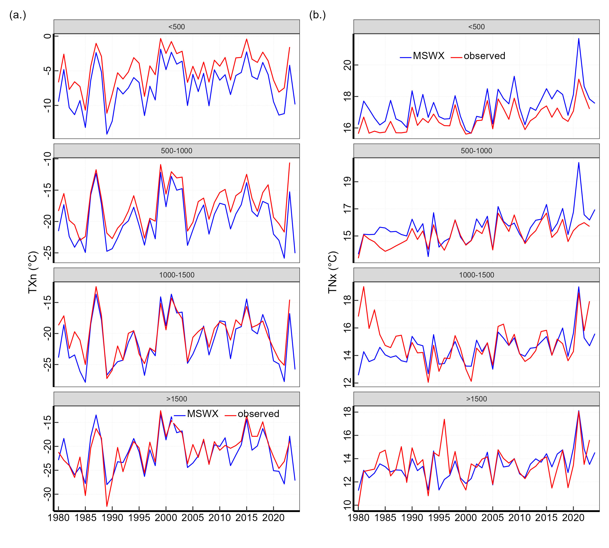{#fig-tnx_txn_ts width="100%"}

#### RX1day and R10mm

@fig-rx1day_ts compares the temporal evolution of RX1day and R10mm across different elevation bands in BC. The agreement between MSWX and observations for these precipitation-related indices is generally weaker than for temperature indices. While the temporal evolution of RX1day is reasonably well captured, observed values are consistently higher than those from MSWX across all elevation bands (@fig-rx1day_ts a). This indicates that MSWX systematically underestimates the wettest precipitation events, suggesting its negative bias in representation of wettest precipitation. Similarly, MSWX consistently and significantly underestimates the number of days with heavy precipitation compared to observations (@fig-rx1day_ts b), likely due to its limitations in accurately capturing localized extreme precipitation events.

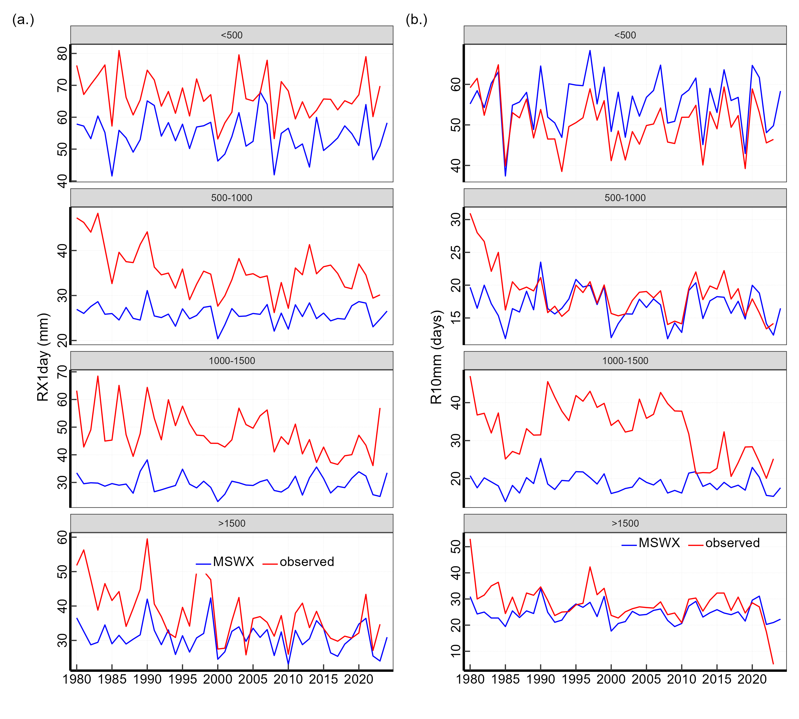{#fig-rx1day_ts width="100%"}

## Sectoral indices (SPEI and Heatwave)

### Standardized Precipitation-Evapotranspiration Index (SPEI)

We calculated the Standardized Precipitation-Evapotranspiration Index (SPEI) drought index as a standardized climatic water balance at multiple time scales (3, 6, and 12 months) following [@Vicente-Serrano2010] using the <a href="https://github.com/ARCCSS-extremes/climpact" target="-blank"> climpact R package </a>, which internally uses the <a href="https://github.com/sbegueria/SPEI"> SPEI R package </a> to compute SPEI values. The climatic water balance $D_i$ was computed as in the equation (i) [@Vicente-Serrano2010]:

$$
D_i = P_i - PET_i                            \tag{i}
$$

where:\
$P_i$ is the accumulated precipitation for period *i*,\
$PET_i$ is the potential evapotranspiration, and\
$D_i$ is the climate water balance.

The resulting $D_i$ time series were then fitted to a log-logistic distribution and standardized (mean = 0, standard deviation = 1) to obtain unitless SPEI values [@Vicente-Serrano2010]. The standardized values of SPEI, therefore account for seasonal and regional variations making it comparable with other SPEI values over time and space. There are different ways to calculate PET (e.g., Thornthwaite, Penman-Monteith, Hargreaves). In <a href="https://bcgov-env.shinyapps.io/bc_climate_extremes_app/" target="_blank"> CEIapp </a> ${ET}_{o}$ which is equivalent to PET is calculated following the modified Hargreaves method, an empirical approach that requires less data and primarily relies on air temperature range (mean, maximum, and minimum) and extraterrestrial radiation (Ra), which can be calculated from latitude and Julian day as in equation (ii)

$${ET}_{o} = 0.0023\  \times Ra\  \times \left( T_{avg} + 17.8 \right) \times {(T_{\max} - T_{\min})}^{0.5}\ \ \ \ \ \ \ \ (ii)$$

where ${ET}_{o} = \ evapotranspiration\ ,$

$Ra = extraterreststial\ radiation$,

$T_{avg},\ T_{\max},T_{\min} = Average\ ,\ \ Maximum\ and\ Minimum\ daily\ temperatures$.

The calculated SPEI can be used to indicate the severity of drought with negative and positive SPEI indicating dry and wet conditions as in @tbl-drght_cond:

| SPEI Value     | Drought Condition |
|----------------|-------------------|
| ≤ -2.00        | Extremely Dry     |
| -1.50 to -1.99 | Severely Dry      |
| -1.00 to -1.49 | Moderately Dry    |
| -0.99 to 0.99  | Normal            |
| 1.00 to 1.49   | Moderately Wet    |
| 1.50 to 1.99   | Very Wet          |
| ≥ 2.00         | Extremely Wet     |

: Categories of drought condition based on SPEI values. {#tbl-drght_cond}

We compare our SPEI values with <a href ="https://spei.csic.es/database.html" target="-blank"> the global SPEI database </a>, that offers long-term (1950-2025) SPEI values at 1° × 1° spatial resolution across globe. The global SPEI database is calculated using the CRU TS 4.09 dataset [@Harris2020] and provides SPEI values for 1 to 48 months period. We compared our MSWX data-based SPEI with global SPEI for a 3, 6 and 12- months period. We subset the global SPEI database for BC and compare this with our SPEI value to explore how well they represent the drought condition in the province through SPEI.

@fig-speijl2023 shows a spatial comparison of SPEI across BC at three temporal scales- 3, 6, and 12 months for July 2023, one of the highest drought months. The figure indicates detailed drought conditions as shown by SPEI with the higher resolution outputs of the CEIapp (left panel) than the coarser-resolution global SPEI (right panel). Although the pattern of SPEI is captured well across BC especially for 3-months period, it differs substantially for 6 and 12 months especially along the Coast Mountains region of BC. Furthermore, the SPEI calculated for CEIapp consistently indicates widespread drought conditions across BC for all three accumulation periods (3, 6, and 12 months). Drought severity intensifies with increasing accumulation periods, a pattern particularly evident in the 12-month SPEI map (@fig-speijl2023 a), which depicts pervasive drought throughout the province. In contrast, the global SPEI dataset exhibits greater spatial variability, with certain regions not indicating drought. Given the inherently regional nature of drought, the SPEI derived from CEIapp appears to provide a more consistent and regionally appropriate representation of drought conditions in BC compared to the global dataset. And the discrepancy likely stems from the datasets (CRU TS 4.09 vs MSWX) and the method used to calculate PET. The global SPEI data estimates PET with the FAO-56 Penman-Monteith method [@Vicente-Serrano2010] while CEIapp uses the Hargreaves method.

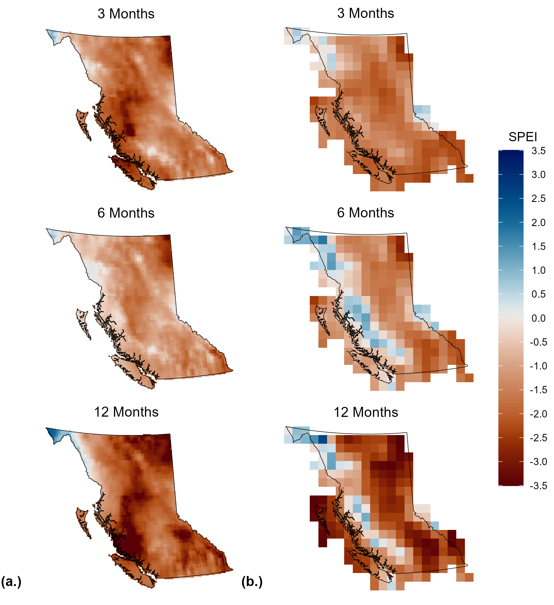{#fig-speijl2023 width="100%"}

Although different methods were used to calculate SPEI in the global SPEI database and CEIapp, we compared the two databases to assess their level of agreement and associated errors across BC. The objective was not validation but a comparative evaluation. We employed Pearson’s correlation, MAE, RMSE, and the Integrated Quadratic Distance (IQD) that quantifies the difference between two distribution functions by integrating the squared differences across their range [@Thorarinsdottir2013] as metrics for this comparison.

The 3-month accumulation of the SPEI shows higher correlation and lower RMSE and IQD between the extreme app and global SPEI datasets (@fig-speicompcoef_plt). This indicates relatively strong agreement at shorter accumulation timescales. However, as the accumulation period increases (e.g., to 6 or 12 months), the correlation weakens and error metrics increase, suggesting greater discrepancies between the datasets with the period of accumulation. This divergence is likely attributable to differences in dataset resolution (MSWX (0.1°) versus CRU TS (1°)) and methodological differences that contribute to the reduced comparability of SPEI values at longer accumulation periods.

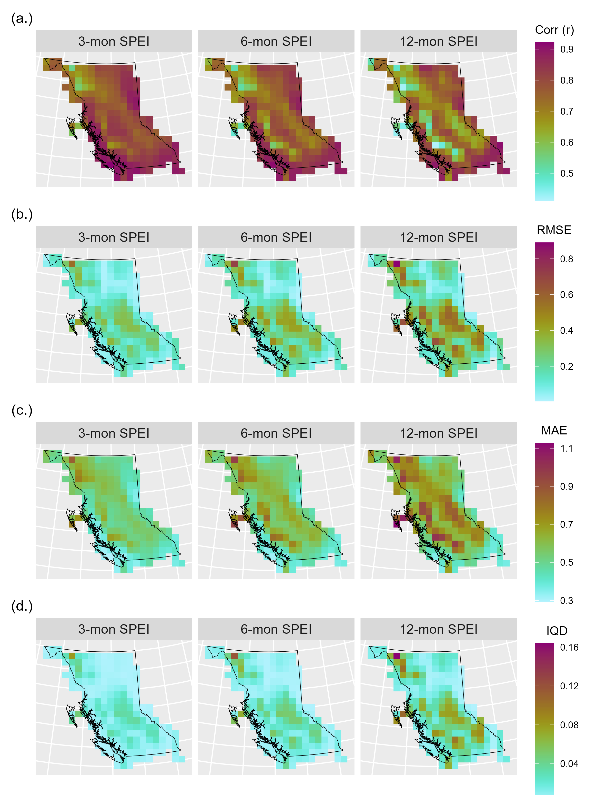{#fig-speicompcoef_plt width="100%"}

### Heatwave

The CEIapp provides heatwave characteristics defined based on three factors: maximum temperature (TX), minimum temperature (TN), and Excess Heat Factor (EHF). The app provides different aspects of heatwaves based on these three factors namely: heatwave frequency, number, magnitude, amplitude, and duration that allows for multifaceted assessment of heatwaves. The daytime and nighttime heatwaves are defined as any period of three or more days when daily maximum temperature (TX) and minimum temperature (TN) exceeds the 90^th^ percentile for the corresponding calendar day, respectively. EHF heatwaves are defined as any period of three or more days when the EHF is positive. EHF is derived as a product of two excess heat indices: ${EHI}_{sig.}$ and ${EHI}_{accl.}$ As in equation (iii). These indices represent the climatological significance of the heat and the potential to acclimatize to the condition, respectively, and are calculated as in equations (iv) and (v) following [@Nairn2013].

$$EHF\  = {EHI}_{sig.} \times \max\left( 1,\ {EHI}_{accl.} \right)\ \ \ \ \ \ \ \ \ \ \ \ \ \ \ \ \ \ \ \ \ \ \ \ \ \ \ \ \ \ \ \ \ \ \ \ \ \ \ \ \ \ \ \ \ \ (iii)$$

$${EHI}_{sig.} = \frac{(T_{i} + T_{i + 1} + T_{i + 2})}{3} - T_{95}\ \ \ \ \ \ \ \ \ \ \ \ \ \ \ \ \ \ \ \ \ \ \ \ \ \ \ \ \ \ \ \ \ \ \ \ \ \ \ \ \ \ \ \ \ \ \ \ \ (iv)$$

$${EHI}_{accl} = \frac{(T_{i} + T_{i + 1} + T_{i + 2})}{3} - \frac{\left( T_{i - 1} + \ldots\ T_{i - 30} \right)}{30}\ \ \ \ \ \ \ \ \ \ \ \ \ \ \ \ \ \ \ \ \ \ (v)$$

where $T_{i}$ is the daily temperature for day $i$ and $T_{95}$ is the 95^th^ percentile of $T_{i}$over all days within the specified base period i.e., 1981-2010.

We compare observed heatwave characteristics across BC with MSWX-based CEIapp heatwave characteristics using both temperature percentiles and EHF based heatwaves. This allows for a better evaluation of heatwave events, capturing not just their intensity but also their potential impact on human well-being. Further, this comparison serves to assess the representativeness of the MSWX dataset, and the reliability of the heatwave indices computed in the CEIapp.

@fig-ehf_tx90_hw_plt shows the temporal evolution of heatwave characteristics based on TX threshold (90^th^ percentile) and EHF. Overall, MSWX reproduces patterns similar to the observations for all heatwave characteristics. While the amplitude and magnitude of TX90-based indices are slightly underestimated in MSWX, the EHF-based indices are more consistent with observations. From an impact assessment perspective, this indicates that EHF-based heatwaves are reasonably well represented in MSWX. Although the number, frequency, and duration of heatwaves tend to be slightly overestimated, MSWX captures the interannual variability of heatwaves well (@fig-ehf_tx90_hw_plt), making it a useful dataset for long-term understanding of heatwaves and their characteristics.

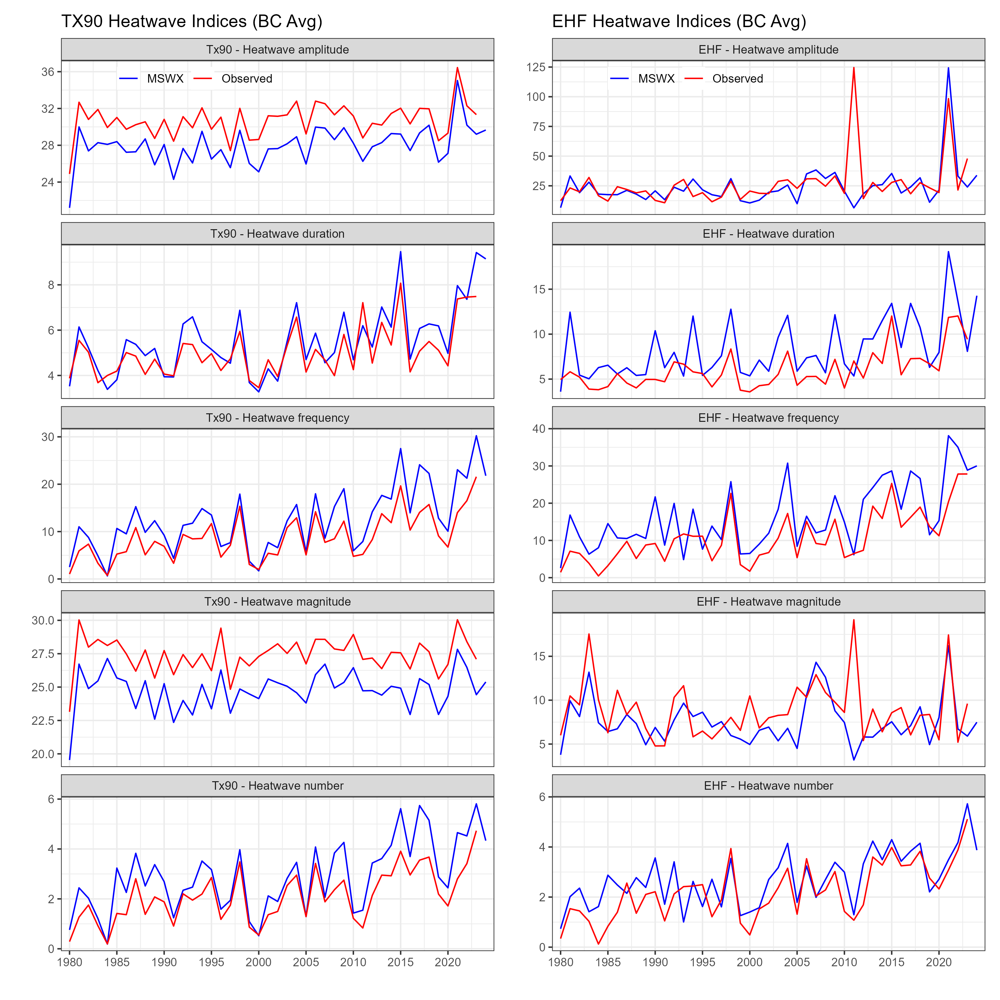{#fig-ehf_tx90_hw_plt width="100%"}

In addition to the long-term comparison of heatwave characteristics, we also assess how well the 2021 heatwave event, one of the most significant in BC’s recent history [@White2023], was represented in MSWX compared to observations. MSWX reproduces the spatial variability of 2021 heatwave magnitude and amplitude across stations fairly well; Tx90-based magnitude and amplitude are generally well captured, though slightly underestimated at higher values (@fig-ehf_tx90_hw21_plt). EHF-based amplitude is broadly consistent with observations but shows greater scatter, while EHF-based magnitude is consistently underestimated, particularly at higher observed values (@fig-ehf_tx90_hw21_plt).

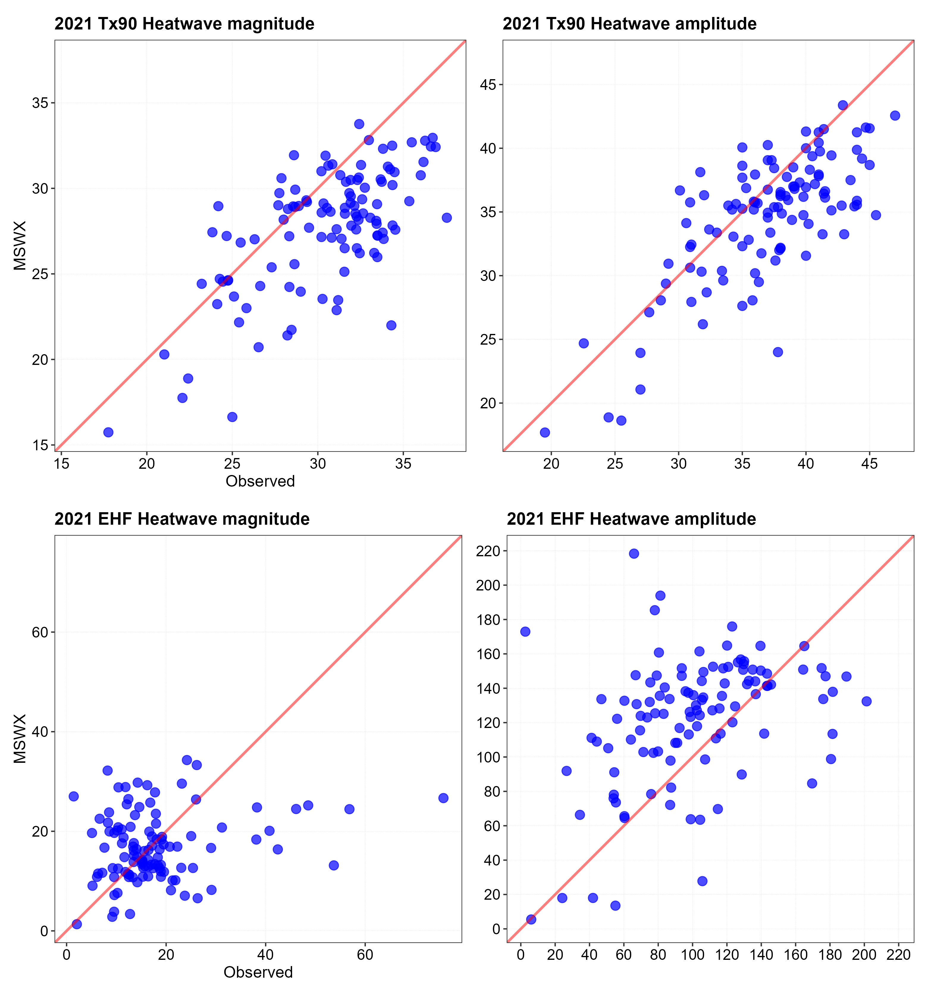{#fig-ehf_tx90_hw21_plt width="100%"}

# Summary and recommendations

## Summary

Observational data are the most accurate data to represent both average climate and climate extremes (CEIs) in any region. However, the use of observational data are constrained by several factors: the paucity of stations with long-term, high-quality records, spatial and temporal data gaps, and the logistical challenges of establishing and maintaining weather stations in complex mountainous and coastal terrain of BC. These limitations necessitate the use of gridded datasets, which, despite their shortcomings, offers regionally consistent coverage and are therefore important for several applications such as understanding climate change, climate extremes, climate extremes impact on ecosystems, watersheds as well as for adaptation planning and implementation in communities. While gridded data may not perfectly capture the occurrence of CEIs at every location, they are often the only viable option for obtaining reasonable information for these purposes. In this context this comparison analysis shows that MSWX reproduces variability and timing of most CEIs reasonably well across BC but with some notable exceptions on the magnitude of CEIs.

Based on the comparative analysis of daily minimum and maximum temperatures, daily precipitation, extreme heat and cold events, heavy precipitation days, warmest days, coldest nights, and sectoral indices such as SPEI and heatwaves, the following key conclusions can be drawn on the quality and limitations of the CEIs calculated and presented in CEIapp.

-   Daily Tmax is slightly underestimated at lower elevations, but the MSWX accuracy in capturing variability improves at higher elevations. Daily Tmin is consistently overestimated, though its variability is well-captured across most stations.

-   The variability of MSWX is slightly lower for Tmax at low elevations but nearly matches observations at higher elevations; Tmin variability closely matches observations.

-   MSWX's representation of daily precipitation is weaker and less reliable than its temperature data. MSWX shows a mean positive bias for daily precipitation that increases with elevation with mixed bias at stations level (positive \>100% and negative \~82%).

-   RMSE and rSD indicate underrepresentation of variability of daily precipitation, particularly at higher elevations and coastal regions. Therefore, the MSWX performance is limited in its ability to accurately capture localized, orographic, and convective precipitation events especially in BC's complex coastal and mountainous terrain.

-   MSWX reasonably captures spatial variability of EHDs and ECDs; ECDs are better represented than EHDs; \>60% of stations have MAE \<5 °C for EHDs, and 99% for ECDs. Coastal and lower-elevation stations show lower errors for both EHDs and ECDs than higher-elevation and interior stations.

-   HPDs are not well represented by MSWX with mean absolute percentage error ranging from 35% to over 90% (mean 57% and media 55%).

-   In terms of timing of extremes given by percentage match, the ECDs are well matched however EHDs and HPDs show lower matches especially along the topographically complex region of BC like coastal area.

-   MSWX captures TXn and TNx annual variability well, with slight under/overestimation at low elevations. Precipitation indices (RX1day, R10mm) are consistently underestimated, especially for higher magnitude events.

-   Although the 3-month SPEI values are comparable between the CEIapp and global SPEI database, the CEIapp-based SPEI shows greater spatial detail and better alignment with regional drought patterns. It also performs more consistently across longer accumulation periods (6- and 12-month), making it a more accurate representation of drought conditions in BC compared to the global SPEI datasets.

-   MSWX reproduces interannual variability, frequency, and duration of heatwaves reasonably well. TX90-based magnitude/amplitude slightly underestimated; EHF-based indices align better with observations making them useful for impact assessments.

-   The 2021 extreme heatwave is fairly well captured spatially, though high-magnitude events are slightly underestimated.

This report provides a preliminary assessment of how well CEIs derived from the MSWX dataset represent climate extremes in BC and offers guidance to users on how to interpret the results from the [CEIapp](https://bcgov-env.shinyapps.io/bc_climate_anomaly/). CEIapp provides relatively reliable representations of temperature extremes, drought, and heatwaves across BC, particularly at low- to mid-elevations. Precipitation, especially extreme events in complex terrain, is less accurately captured.

## Recommendations

We recommend that users apply the following considerations when using the data or interpreting results from CEIapp:

-   **Minimum temperature indices** (e.g., frost days, cold nights, coldwave): The app performs very well across provinces and provides reliable information.

-   **Maximum temperature indices** (e.g., warm days, heat extremes): The app performs fairly well at the regional scale. However, caution is advised when interpreting peak extreme events, as these may be less accurately captured.

-   **Precipitation indices**: The app performs reasonably well across BC, making it suitable for understanding broad patterns and temporal trends in precipitation extremes. However, for localized and highly intense precipitation events, the app may not provide sufficiently reliable extreme information.

-   **Sectoral indices** (e.g., SPEI for drought, heatwaves): The app provides a fairly accurate and spatially comprehensive representation of sectoral indices. Users can use these sectoral CEIs with fairly good confidence.

# Known issues and limitations of data and CEIs

There are inherent limitations and caveats not only within the MSWX dataset itself but also in the indices calculated through CEIapp, due to the way MSWX was assimilated and how CEIapp processes the data. Although MSWX data makes significant improvement over other similar gridded data, e.g., ERA5, it has known limitations. Some of the MSWX data limitations to be considered while using the CEIapp include:

-   **Suppression or amplification of extremes**: While MSWX shows improvements over other widely used gridded datasets (e.g., ERA5), it may still suppress or amplify trends in extremes, particularly for precipitation. Moreover, MSWX tends to overestimate light to moderate precipitation while simultaneously underestimating heavy precipitation ((Beck et al. 2022) and Figure 4).

-   **Smoothing of localized extremes**: Like other gridded datasets, the spatial resolution of MSWX (0.1° × 0.1°) smooths out localized extreme events that are often better captured by station-based observations. Similarly, the accuracy of MSWX data can be significantly reduced in regions with complex topography, such as mountainous areas. This is because the downscaling process struggles to capture the fine-scale meteorological variations induced by steep terrain.

-   **Shift in diurnal cycle**: Because MSWX downscales ERA5, slight shifts in the diurnal cycle may occur. This can influence certain CEIs that are sensitive to instantaneous values, such as extreme precipitation events.

-   **Caveats in the app**:

    -   While the app and calculated CEI data have been thoroughly reviewed, the large number of indices and datasets means occasional inconsistencies are still possible. Users who notice any issues are encouraged to report them through the app's feedback form or by email.
    
    -   Some CEIs, especially monthly indices, may have occasional missing values (shown as blank spaces). These gaps arise either from missing source data or from implausible values that prevent calculation of the indices.

    -   Any caveats and limitations in the underlying data also apply to the app values. Future updates or revisions to the source data may change the results shown in the app and any comparisons presented here.

This evaluation and comparison of CEIs, along with the MSWX input data used to calculate them in CEIapp, provide an initial level of confidence as well as important insight into the uncertainties surrounding how well MSWX-based CEIs are represented. The purpose of this assessment is to help users understand the strengths and limitations of CEIapp outputs and to guide how the data and results might be applied in practice. While CEIapp offers valuable information for analyzing climate extremes across BC, users are encouraged to view these results as one line of evidence and to exercise professional judgment when interpreting and applying them, especially in contexts where high accuracy or localized detail is required.

# References

::: {#refs}
:::

# Appendix

######## Appendix 1: List of the CEIs with their definition, units and descriptions {#appendix1}

Modified from <a href="https://github.com/ARCCSS-extremes/climpact/blob/master/www/user_guide/Climpact_user_guide.md">Climpact R package user guide</a>.

::: {#tbl-climate_indices .table-responsive style="overflow-x:auto; font-size:0.65em; white-space: nowrap;"}
| Index | Index_name | Units | Definition | Description | Timescale |
|:-----------|:-----------|:-----------|:-----------|:-----------|:-----------|
| CDD (cdd) | Consecutive Dry Days | days | Maximum number of consecutive dry days (when PR \< 1) | Longest dry spell | Ann |
| CDDcoldn (cddcold18) | Cooling Degree Days | degree-days | Annual sum of TM - n (n = 18) | Energy demand for cooling a building | Ann |
| CSDI (csdi) | Cold spell duration indicator | days | Annual number of days contributing to events where 6+ consecutive days experience TN \< 10th percentile | Number of days contributing to cold period (≥6 days) | Ann |
| CSDId (csdi5) | User-defined CSDI | days | Annual number of days contributing to events where d+ consecutive days experience TN \< 10th percentile | Number of days contributing to cold period (≥5 days) | Ann |
| CWD (cwd) | Consecutive Wet Days | days | Maximum annual number of consecutive wet days (PR ≥ 1) | Longest wet spell | Ann |
| DTR (dtr) | Daily Temperature Range | °C | Mean difference between daily TX and daily TN | Average range of max/min temp | Mon/Ann |
| FD (fd) | Frost Days | days | Days when TN \< 0°C | Days with minimum temp below 0°C | Mon/Ann |
| GDDgrown (gddgrow10) | Growing Degree Days | degree-days | Annual sum of TM - n (TM \> n, location-specific) | Heat accumulation for plant/animal growth | Ann |
| GSL (gsl) | Growing Season Length | days | Annual number of days between first 6-day TM \> 5°C and first 6-day TM \< 5°C | Length of growing season | Ann |
| HDDheatn (hddheat18) | Heating Degree Days | degree-days | Annual sum of n - TM (TM \< n, location-specific) | Energy demand for heating | Ann |
| HW (hw) | Heatwave / Coldwave indices | °C / °C² / days / count | Metrics based on TX/TN for Tx90, Tn90, EHF, ECF | Duration, magnitude, amplitude, number, frequency | Ann |
| ID (id) | Ice Days | days | Number of days when TX \< 0°C | Days with maximum temp below 0°C | Mon/Ann |
| PRCPTOT (prcptot) | Annual total wet-day precipitation | mm | Sum of daily PR ≥ 1 | Total wet-day rainfall | Mon/Ann |
| R10mm (r10mm) | Heavy rain days | days | Number of days when PR ≥ 10 mm | Days with rainfall ≥ 10 mm | Mon/Ann |
| R20mm (r20mm) | Very heavy rain days | days | Number of days when PR ≥ 20 mm | Days with rainfall ≥ 20 mm | Mon/Ann |
| Rnnmm (r30mm) | Customized rain days | days | Number of days when PR ≥ user-specified threshold | Days with rainfall ≥ user-specified mm | Mon/Ann |
| R95p (r95p) | Total annual precipitation from heavy rain | mm | Annual sum of daily PR \> 95th percentile | Amount of rainfall from very wet days | Ann |
| R95pTOT (r95ptot) | Contribution from very wet days | \% | 100\*r95p / PRCPTOT | Fraction of total wet-day rainfall from very wet days | Ann |
| R99p (r99p) | Total annual precipitation from extreme rain | mm | Annual sum of daily PR \> 99th percentile | Amount of rainfall from extremely wet days | Ann |
| R99pTOT (r99ptot) | Contribution from extremely wet days | \% | 100\*r99p / PRCPTOT | Fraction of total wet-day rainfall from extremely wet days | Ann |
| Rx1day (rx1day) | Max 1-day precipitation | mm | Maximum 1-day PR | Maximum rain in 1 day | Mon/Ann |
| Rx5day (rx5day) | Max 5-day precipitation | mm | Maximum 5-day PR | Maximum rain in 5 consecutive days | Mon/Ann |
| RXdday (rx7day) | User-defined consecutive days PR | mm | Maximum d-day PR | Maximum rainfall in user-defined period | Mon/Ann |
| SDII (sdii) | Daily precipitation intensity | mm/day | Annual total PR divided by #wet days (PR ≥ 1) | Average wet-day rainfall intensity | Ann |
| SPEI (spei) | Standardised Precipitation Evapotranspiration Index | unitless | Standardised PR-PET balance | Measure of drought on 3, 6, 12 month scales | Mon |
| SPI (spi) | Standardised Precipitation Index | unitless | Standardised PR anomaly | Measure of drought on 3, 6, 12 month scales | Mon |
| SU (su) | Summer Days | days | Number of days when TX \> 25°C | Days with maximum temp \> 25°C | Mon/Ann |
| TMge10 (tmge10) | Days with TM ≥ 10°C | days | Number of days TM ≥ 10°C | Days when average temp ≥ 10°C | Mon/Ann |
| TMge5 (tmge5) | Days with TM ≥ 5°C | days | Number of days TM ≥ 5°C | Days when average temp ≥ 5°C | Mon/Ann |
| TMlt10 (tmlt10) | Days with TM \< 10°C | days | Number of days TM \< 10°C | Days when average temp \< 10°C | Mon/Ann |
| TMlt5 (tmlt5) | Days with TM \< 5°C | days | Number of days TM \< 5°C | Days when average temp \< 5°C | Mon/Ann |
| TMm (tmm) | Mean daily temperature | °C | Mean daily mean temperature | Average daily temperature | Mon/Ann |
| TN10p (tn10p) | Cold nights | \% | \% of days TN \< 10th percentile | Fraction of cold nights | Ann |
| TN90p (tn90p) | Warm nights | \% | \% of days TN \> 90th percentile | Fraction of warm nights | Ann |
| TNlt2 (tnlt2) | TN \< 2°C | days | Number of days TN \< 2°C | Mild frost nights | Mon/Ann |
| TNltm2 (tnltm2) | TN \< -2°C | days | Number of days TN \< -2°C | Frost nights | Mon/Ann |
| TNltm20 (tnltm20) | TN \< -20°C | days | Number of days TN \< -20°C | Extreme cold nights | Mon/Ann |
:::
